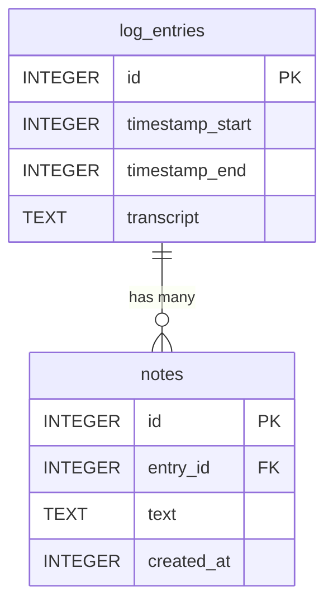

# Database ERD

## Notes

- All timestamps are Unix epoch milliseconds
- `id` fields use `INTEGER PRIMARY KEY AUTOINCREMENT` (SQLite rowid alias)
- `notes.entry_id` references `log_entries.id` (no FK constraint enforced yet — will be added with cascade delete when user/sync tables are introduced)
